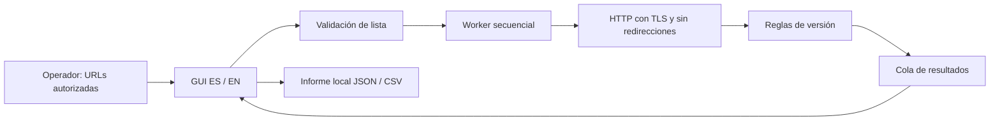

# Plan de implementación y mantenimiento

## Arquitectura

La GUI valida la lista antes de crear un hilo de trabajo. El worker consulta URLs en serie y comunica resultados mediante una cola; solo el hilo principal toca Tkinter. El núcleo normaliza URLs, realiza HTTP, interpreta la versión y genera informes. Los textos de presentación y la versión del producto están separados de las reglas PHP.

## Secuencia

| Etapa | Trabajo | Requisitos | Evidencia esperada |
| --- | --- | --- | --- |
| 1 | Fijar alcance, estados y umbrales PHP. | RF-02/03, RNF-05 | Especificación y pruebas de fronteras de versión. |
| 2 | Validar listas y robustecer HTTP e informes. | RF-01/05, RNF-01/02/03/04 | Servidor de loopback, entradas inválidas, errores y exportación. |
| 3 | Completar GUI, idiomas y donación. | RF-04/06/07/08/09 | Pruebas de selección, traducción, cancelación y enlace sin abrir navegador en tests. |
| 4 | Añadir packaging, icono y versión única. | RNF-06/07 | Validación de build y compilación Windows local. |
| 5 | Preparar documentación, licencia, roles y skills. | RNF-08/09 | Enlaces internos, instrucciones completas y archivos versionados. |
| 6 | Crear repositorio, primer commit y push a main. | RNF-07/09 | URL del repositorio y hash del commit. |
| 7 | Verificar Actions, tag y release. | RNF-07 | Ejecución satisfactoria y artefactos descargables con SHA-256. |

El progreso comprobado se registra en [tasks.md](tasks.md). Preparar un workflow no equivale a demostrar que ya se ejecutó; publicar un release requiere comprobar el resultado en GitHub.

## Validación

- Ejecutar `python -m unittest discover -s tests -v` con HTTP limitado a loopback.
- Verificar la sincronización con `python scripts/bump_version.py --check` y `python build.py --check`.
- Revisar el código y dependencias con las herramientas de desarrollo configuradas, documentando los límites de su alcance.
- Compilar en Windows con `python build.py`; confirmar nombre del archivo y checksum.
- Revisar que la GUI inicia desde código y desde el ejecutable, muestra versión, usa el icono y permite cambiar idioma.
- Comprobar que el conjunto preparado para Git no contiene secretos, entornos virtuales, informes de clientes ni binarios de build.
- Después del push, consultar Actions y el release de la versión. No marcar esas tareas como completadas solo por haber enviado el push.

## Evolución

Un cambio de reglas PHP requiere fuente oficial, fecha, casos límite y advertencias de backports. Una nueva función requiere criterio de aceptación antes de implementarse. Cambios incompatibles de los informes exigen `major`; funciones compatibles, `minor`; correcciones compatibles, `patch`. Las dependencias de compilación se actualizan de forma explícita, revisando el resultado de tests, revisión y build.
